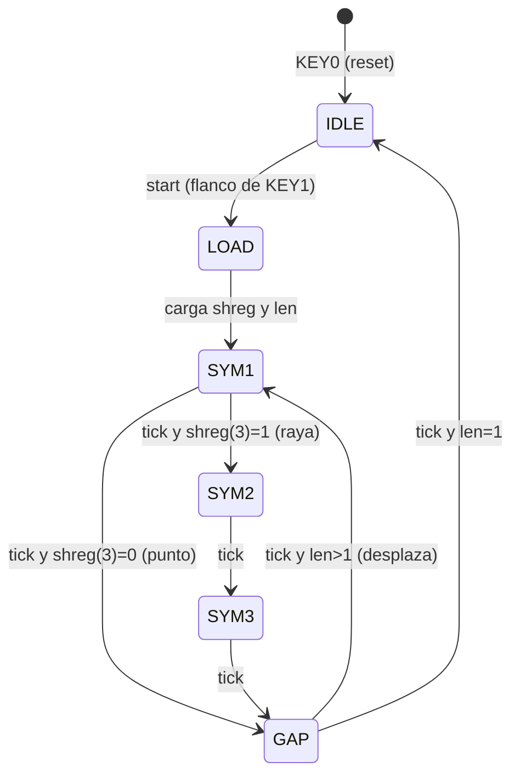
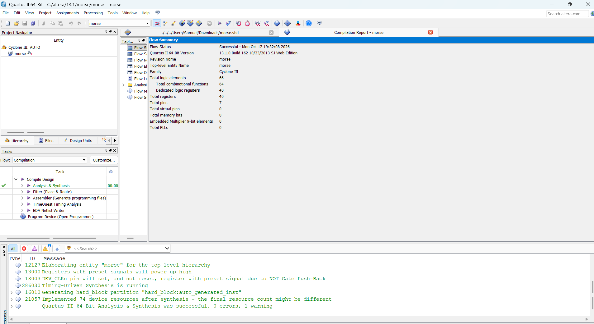
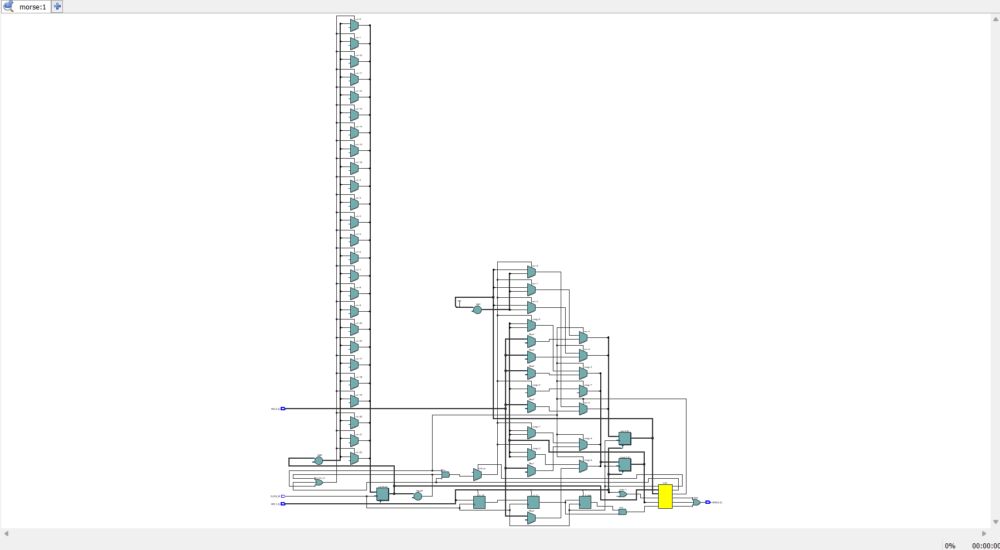
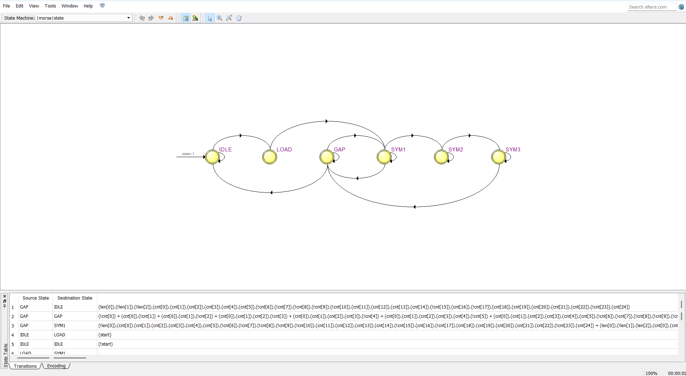
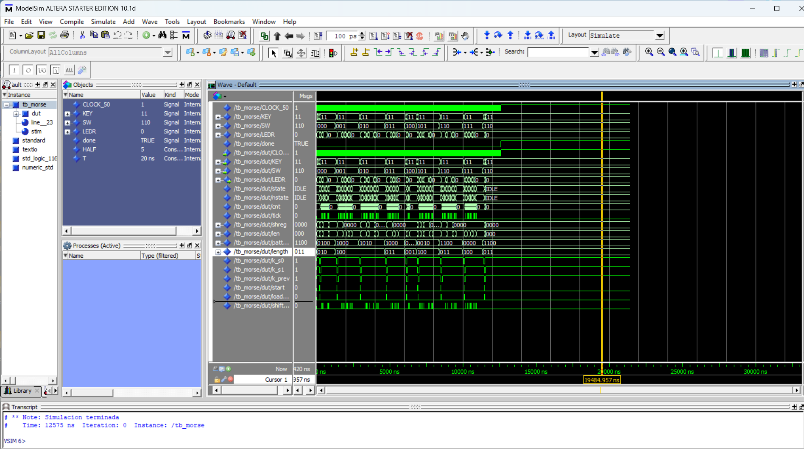
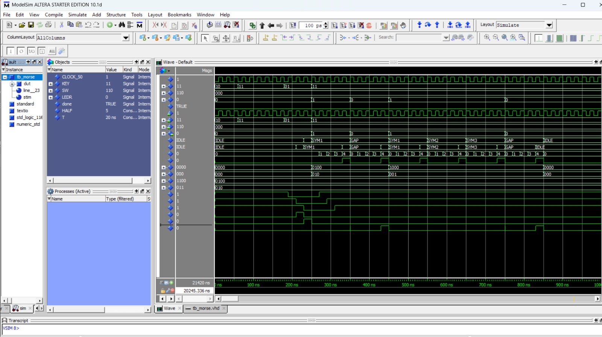
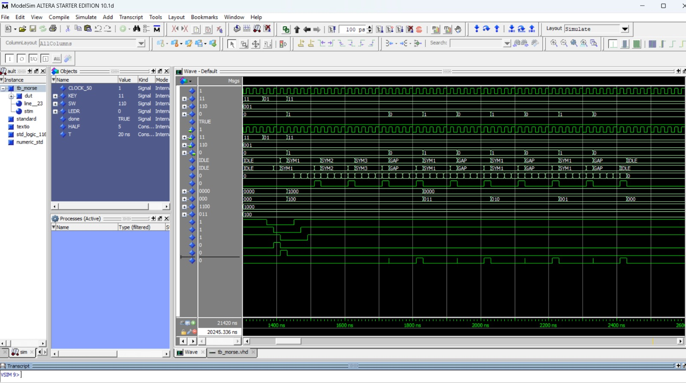
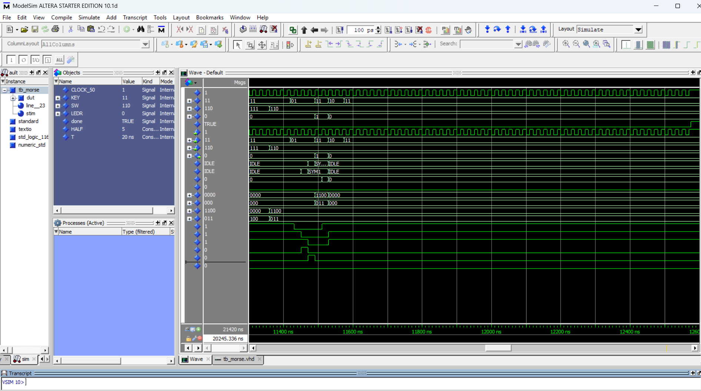

# Laboratorio 7 – Parte IV: Codificador Morse con FSM

Codifica una de las primeras 8 letras (A–H) en código Morse sobre `LEDR0`.

| Entrada | Función |
|---|---|
| `SW[2:0]` | Letra (000 = A, 001 = B, … 111 = H) |
| `KEY1` | Inicia la transmisión (activo en bajo) |
| `KEY0` | Reset asíncrono (activo en bajo) |
| `LEDR0` | Salida Morse: punto = 0.5 s, raya = 1.5 s, pausa entre símbolos = 0.5 s |

## Arquitectura (Figura 5 del enunciado)
- **Letter selection logic**: `SW` → patrón (0 = punto, 1 = raya, MSB primero) y longitud.
- **Morse code shift register** (4 bits) y **length counter** (3 bits), con `Load` y `Enable`.
- **Half-second counter**: 25 000 000 ciclos de `CLOCK_50`.
- **FSM** de 6 estados.

## Diagrama de la máquina de estados (FSM)



Salida: `LEDR0 = 1` en `SYM1`, `SYM2`, `SYM3`; `0` en `IDLE`, `LOAD`, `GAP`.
Todos los estados regresan a `IDLE` con `KEY0 = 0` (asíncrono).

| Letra | Morse | Patrón | Longitud |
|---|---|---|---|
| A | .- | 0100 | 2 |
| B | -... | 1000 | 4 |
| C | -.-. | 1010 | 4 |
| D | -.. | 1000 | 3 |
| E | . | 0000 | 1 |
| F | ..-. | 0010 | 4 |
| G | --. | 1100 | 3 |
| H | .... | 0000 | 4 |

## Archivos
| Entregable del laboratorio | Archivo |
|---|---|
| Diagrama de la máquina de estados (FSM) | Este README (diagrama de arriba) y `media/3_state_machine_viewer.png` |
| Código VHDL de la FSM | `morse.vhd` |
| Testbench de la FSM | `tb_morse.vhd` |
| Implementación y prueba del FSM | Sección "Pruebas realizadas" (síntesis y simulación) |

## Pruebas realizadas

### Síntesis en Quartus II 13.1
Analysis & Synthesis terminó con 0 errores (66 elementos lógicos, 40 registros, 7 pines).



El RTL Viewer y el State Machine Viewer muestran la FSM sintetizada con sus 6 estados (IDLE, LOAD, SYM1, SYM2, SYM3, GAP):




### Simulación en ModelSim-Altera Starter Edition 10.1d
El testbench `tb_morse.vhd` es autoverificable: aplica las 8 letras (A–H), comprueba ranura por ranura (cada ranura = 0.5 s) que `LEDR0` coincida con el código Morse esperado, y prueba el reset asíncrono a mitad de una transmisión. Para simular rápido usa `HALF_SEC_CYCLES = 5`. Resultado: sin errores y mensaje final "Simulacion terminada".



Letra A (`.-`, `SW = 000`): punto de 1 ranura, pausa, raya de 3 ranuras, pausa.



Letra B (`-...`, `SW = 001`): raya de 3 ranuras y tres puntos.



Reset asíncrono (`KEY0 = 0`) a mitad de la letra G: `LEDR0` baja a 0 de inmediato y la FSM vuelve a IDLE.



### Limitaciones
- No se hizo prueba en placa física por no contar con una. Para la placa se usa el valor por defecto `HALF_SEC_CYCLES = 25_000_000` (reloj de 50 MHz) y se asignan los pines como se indica abajo.
- La compilación completa en Quartus (etapa Fitter) falló por un error interno de la instalación de Quartus II 13.1 en el equipo usado (no pudo cargar una librería), por lo que solo se completó Analysis & Synthesis.

## Cómo reproducir
**Simulación (ModelSim):**
```
cd <carpeta del proyecto>
vlib work
vcom morse.vhd tb_morse.vhd
vsim work.tb_morse
add wave -r /*
run -all
```

**Placa (Quartus):** nuevo proyecto con `morse` como top-level, agregar solo `morse.vhd` (no el testbench), asignar pines, compilar y programar.

| Señal | DE1-SoC | DE10-Lite |
|---|---|---|
| CLOCK_50 | PIN_AF14 | PIN_P11 |
| KEY[0] | PIN_AA14 | PIN_B8 |
| KEY[1] | PIN_AA15 | PIN_A7 |
| SW[0] | PIN_AB12 | PIN_C10 |
| SW[1] | PIN_AC12 | PIN_C11 |
| SW[2] | PIN_AF9 | PIN_D12 |
| LEDR[0] | PIN_V16 | PIN_A8 |

Verifica los pines con el manual de tu placa.
